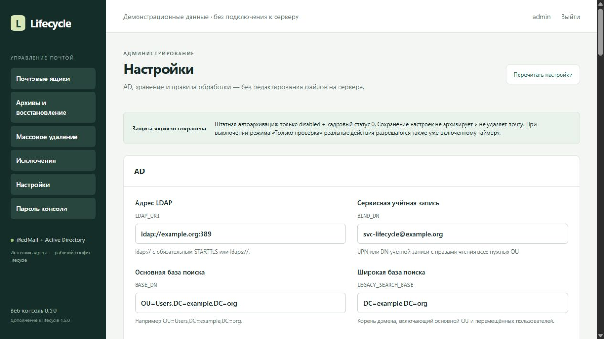
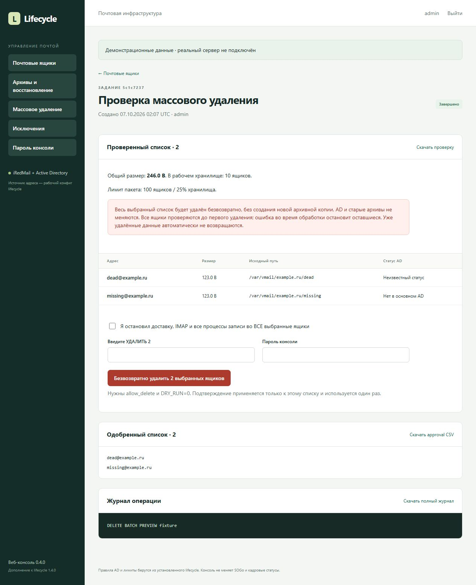
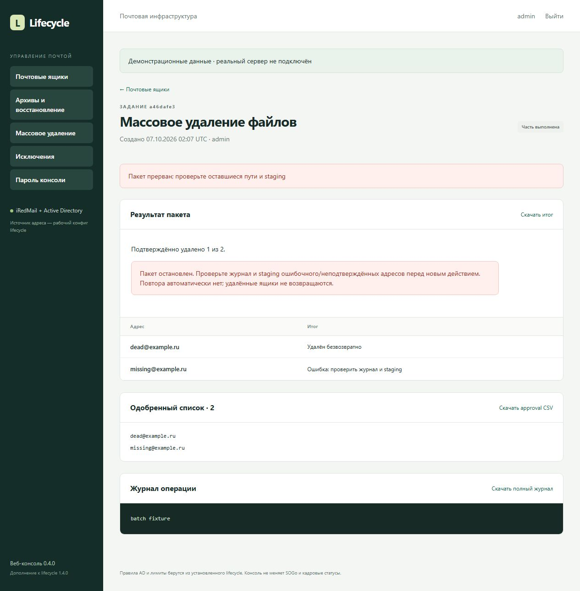

# iRedMail AD Lifecycle

**AD-aware mailbox lifecycle management for iRedMail with a web console.**

[Русский](README.md) · [Installation and upgrade](docs/INSTALL.md) · [Settings RU/EN](docs/SETTINGS.md) · [AGPL-3.0](LICENSE)

**Core 1.5.0 / console 0.5.0.** Bash and Python, with Flask/Gunicorn behind an existing HTTPS Nginx or Apache site. The console UI is Russian; documentation is available in Russian and English. This manages an existing AD-backed iRedMail installation; it does not install a mail server or Active Directory.



## Features

- Web settings for AD, credentials, domains, storage, limits and the timer, with configuration backups and restore.
- Mailbox reports with AD state, HR status, address conflicts and exclusions.
- Automatic archival only for a unique primary address, disabled AD account and `extensionAttribute6=0`, subject to configured delays and safety checks.
- Legacy inventory of AD-missing mailboxes: CSV, size, latest filesystem activity, inactivity age, explicit approval and broad-base AD rechecks.
- Archive restore without overwriting existing mailboxes; automatic exclusion after restore.
- Persistent exclusions respected by processing and archive retention.
- Explicit single and batch permanent mailbox-file deletion, with exact-list preview, reauthentication and confirmation.
- Local console password change and root-only recovery.
- Integration into an existing HTTPS site at `/lifecycle/`, including separate public URL and server/CNAME target.

## Processing policy

| AD state | Normal automatic processing |
| --- | --- |
| Enabled | Keep |
| Disabled + HR status 0, unique primary match | Eligible for archive, subject to other checks |
| Disabled + HR status 1–8 | Keep |
| Disabled + missing or unknown HR status | Keep |
| Missing from the normal search base | Keep; separate legacy review and approval required |
| Alias-only, ambiguous or excluded | Keep |

The sample configuration uses `userPrincipalName`, matching SOGo installations with `MailFieldNames=(userPrincipalName)`. Match your actual mail-stack configuration; explicitly select `mail` if that is your source. Broad presence checks also consider UPN, `mail` and SMTP aliases. An OU move must not be mistaken for deletion. The 0–8 HR mapping is project policy, not a built-in AD standard.

## Getting started

Target environment: Ubuntu 22.04/24.04, Python 3.10+, systemd and an existing AD/iRedMail deployment. The supported layout is a verified `VMAIL_ROOT/domain/login` mailbox directory containing Maildir; arbitrary iRedMail storage layouts are not automatically discovered.

```bash
git clone https://github.com/stepm65/iredmail-ad-lifecycle.git
cd iredmail-ad-lifecycle
sudo bash install.sh
```

The installer asks for the HTTPS URL, server/CNAME target and console password. Then open **Настройки** (Settings) to configure AD, its service password, domains, storage, retention and limits. Test the connection, save and generate a report. Routine setup no longer requires editing files in the terminal. Enable the timer separately in the admin page.

The existing HTTPS certificate must cover the public name. [Installation/upgrade](docs/INSTALL.md) · [Web settings, backups and restore](docs/SETTINGS.md).

For an existing installation, run `sudo bash upgrade.sh` from the repository root after queued jobs finish. Settings, password/URL, state, exclusions and archives are preserved.

## Reviewed cleanup

For a multi-year backlog, start with [legacy inventory](core/README.md), configure `LEGACY_SEARCH_BASE` broadly enough to cover moved accounts, and review last filesystem activity. Missing accounts require explicit legacy approval and are never automatically archived in normal mode. Return to `LEGACY_MODE=0` after the one-time cleanup.

Batch deletion accepts confirmed broad-AD-missing mailboxes or unique primary disabled accounts whose HR status is outside 0–8. An enabled account with no HR status is ineligible. The action **permanently removes working mailbox files without creating a new archive**. AD accounts, delivery settings, SOGo and existing archives remain unchanged. Delivery may recreate files unless recipient acceptance is disabled separately.

Deletion requires all writers quiesced, `DRY_RUN=0`, separate `allow_delete` permission, the console password and exact `УДАЛИТЬ N` confirmation. Defaults are **100 mailboxes and 25% of all working mailbox count** in configured domains, not a percentage of disk bytes. Errors stop the remaining items; deleted data is not automatically rolled back.

[Batch operations RU/EN](docs/BATCH_DELETE.md) · [Restore and exclusions](core/OPERATIONS.md) · [Password administration](console/ADMINISTRATION.md)

## Screenshots

All screenshots use demo data; no production server was connected.





The 0.4.0 screenshot's “25% хранилища” label refers to mailbox **count**, not disk usage.

## Validation and scope

The new release tests settings, rollback, the Unix broker and locks alongside existing processing cases on temporary mailbox fixtures. [1.5.0 validation](docs/VALIDATION-1.5.0.md) · [GitHub Actions](https://github.com/stepm65/iredmail-ad-lifecycle/actions). LDAP is mocked; real AD, HTTPS, archive mounts and mail-host upgrades require deployment validation.

Licensed under [AGPL-3.0](LICENSE). This project is not an official iRedMail component.

## License and contributions

Copyright (c) 2026, rslpro. This publication is licensed under **GNU AGPL version 3 only** (`AGPL-3.0-only`); see [LICENSE](LICENSE) and [NOTICE](NOTICE). Distribution of derivative versions must comply with the AGPL source requirements. A modified version supporting remote network interaction must offer its corresponding source to users interacting with it remotely. Commercial use is permitted.

Please send improvements as pull requests to this repository; see [CONTRIBUTING.md](CONTRIBUTING.md). Sending a pull request is voluntary, not an additional license condition or copyright assignment. Current release: `v1.5.0`, core/console 1.5.0/0.5.0. Previously granted BSD permissions remain valid. See [licensing and validation notes](docs/LICENSING.md).
