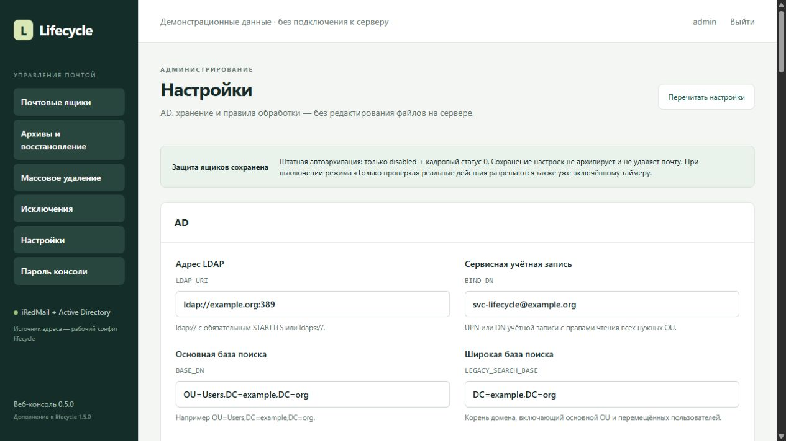
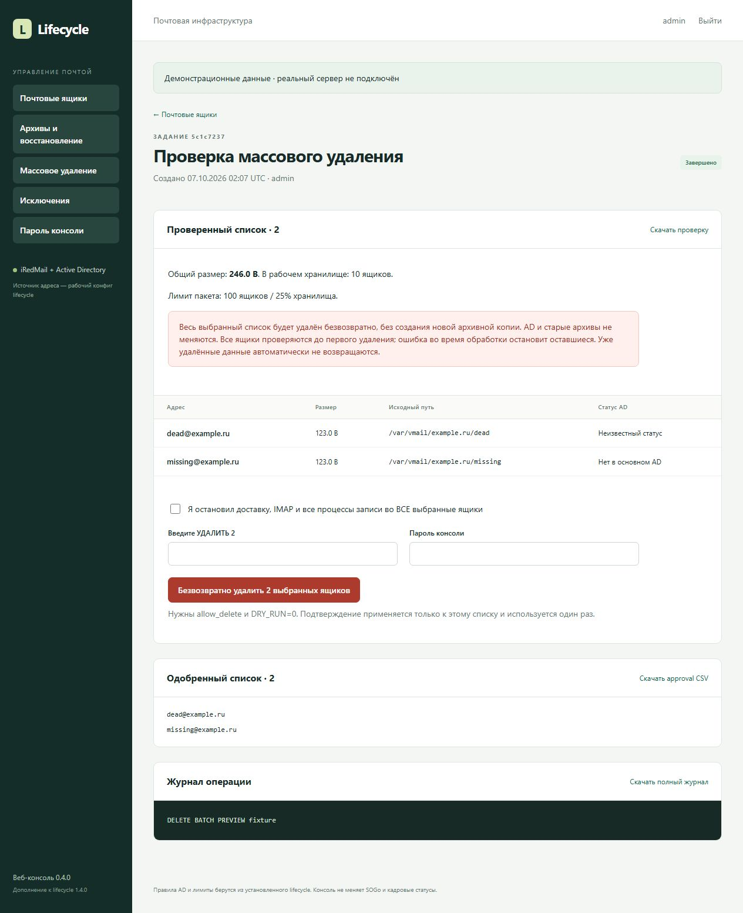
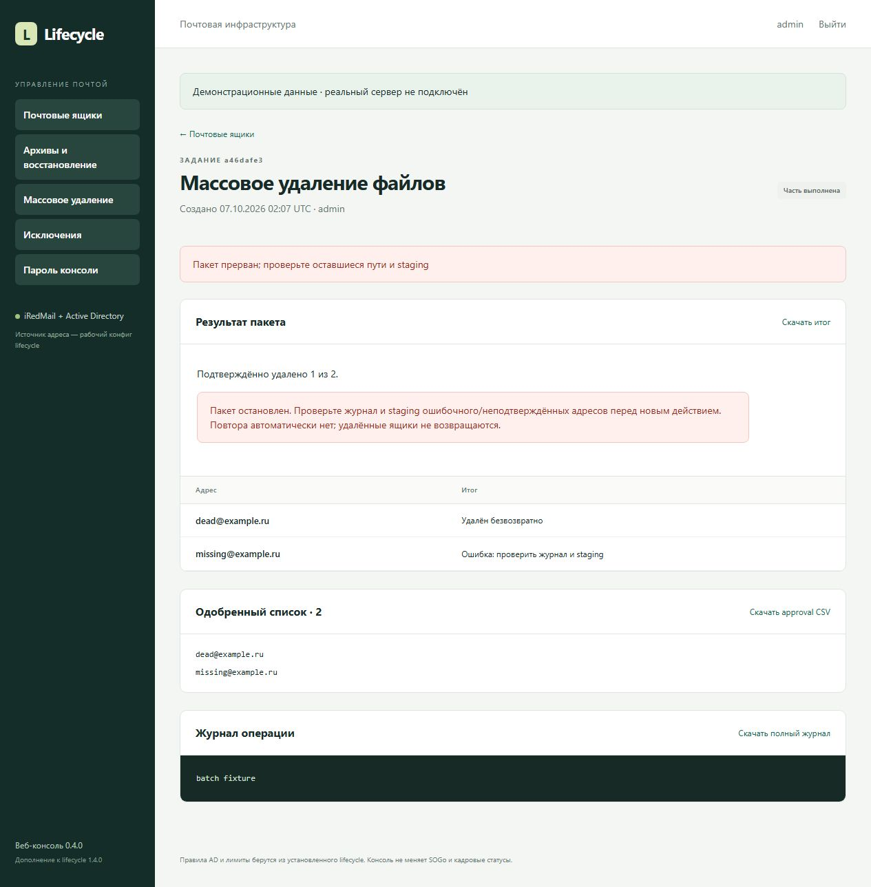

# iRedMail AD Lifecycle

**Управление жизненным циклом почтовых ящиков iRedMail по данным Active Directory — с веб-консолью.**

[English](README.en.md) · [Установка и обновление](docs/INSTALL.md) · [Настройки RU/EN](docs/SETTINGS.md) · [AGPL-3.0](LICENSE)

Версии: **lifecycle 1.5.0 / web console 0.5.0**. Bash и Python; веб-интерфейс на Flask/Gunicorn за существующим HTTPS Nginx или Apache. Интерфейс консоли на русском, документация на русском и английском. Проект предназначен для существующего iRedMail с AD; почтовый сервер и Active Directory он не устанавливает.



*Скриншоты содержат демонстрационные данные. Реальный сервер при их создании не подключался.*

## Возможности

- Настройка AD, пароля, доменов, хранения, лимитов и таймера через админку; копии и откат настроек.
- Отчёт по ящикам: состояние AD, кадровый статус, конфликты адресов и исключения.
- Штатная архивация только при однозначном основном адресе, отключённой УЗ AD и `extensionAttribute6=0`.
- Отдельная очистка старых ящиков, отсутствующих в AD: CSV-инвентаризация, последняя файловая активность, согласование списка и повторный поиск по широкой базе AD.
- Восстановление из архива без перезаписи существующего ящика; восстановленный адрес автоматически исключается из обработки.
- Постоянные исключения из обработки, включая очистку архивов по сроку хранения.
- Ручное одиночное и массовое безвозвратное удаление подходящих почтовых файлов после проверки списка, повторной аутентификации и подтверждения.
- Смена пароля веб-консоли и восстановление доступа через локальный root-доступ.
- Подключение `/lifecycle/` к существующему HTTPS-сайту, настройка публичного URL и отдельного имени сервера/CNAME.

## Правила обработки

| Состояние | Штатный автоматический режим |
| --- | --- |
| AD активна | Не трогать |
| AD отключена, `extensionAttribute6=0`, однозначное основное совпадение | Разрешена архивация с дополнительными проверками и настроенными задержками |
| AD отключена, статус 1–8 | Не трогать |
| AD отключена, статус пустой или неизвестный | Не трогать |
| Нет пользователя в основной базе поиска | Не трогать; отдельная legacy-проверка и явное одобрение |
| Алиас, неоднозначное совпадение или исключение | Не трогать |

Настройка адреса должна соответствовать **вашему** почтовому стеку. Пример использует `ADDRESS_ATTRIBUTE=userPrincipalName`, подходящий для SOGo с `MailFieldNames=(userPrincipalName)`. Если рабочая конфигурация использует `mail`, выберите его явно. Широкая проверка присутствия также учитывает UPN, `mail` и SMTP-алиасы. Переезд пользователя в другой OU не должен считаться удалением.

Кадровые значения 0–8 — политика этого проекта, а не стандарт AD. Проверьте соответствие своей кадровой системе перед включением автоматической обработки.

## Установка

Целевая среда: Ubuntu 22.04/24.04, Python 3.10+, systemd, существующие iRedMail и AD. Поддерживается проверяемая структура `VMAIL_ROOT/domain/login` с Maildir; это не универсальный сканер произвольной иерархии `/var/vmail`.

```bash
git clone https://github.com/stepm65/iredmail-ad-lifecycle.git
cd iredmail-ad-lifecycle
sudo bash install.sh
```

Установщик запросит HTTPS URL, имя сервера/CNAME и пароль консоли. После установки откройте **Настройки**: заполните AD, пароль сервисной УЗ, домены, хранилище, сроки и лимиты. Проверьте подключение, сохраните и создайте отчёт. Редактировать конфиги в терминале для обычной настройки больше не требуется. Таймер включается отдельно в админке.

Сертификат существующего сайта должен покрывать публичное имя. [Установка и обновление](docs/INSTALL.md) · [Настройка через браузер, копии и откат](docs/SETTINGS.md).

Для уже установленного комплекта из корня репозитория:

```bash
sudo bash upgrade.sh
```

Обновление сохраняет рабочие настройки, пароль/URL, состояния, исключения и архивы. Дождитесь завершения заданий перед обновлением.

## Очистка накопившихся ящиков

Для многолетних `missing` начните с [legacy-инвентаризации и одобрения](core/README.md), задайте `LEGACY_SEARCH_BASE` на уровне всего нужного AD-каталога и проверьте возраст последней файловой активности. Архивирование отсутствующих пользователей требует отдельного явного разрешения; штатный режим этого не делает. После разовой очистки верните `LEGACY_MODE=0`.

Для окончательного удаления откройте «Массовое удаление», выберите подходящие адреса и создайте проверку. Удаление допускается для подтверждённого `missing` либо уникального основного `unknown-disabled` с кадровым статусом вне 0–8. Активная УЗ с пустым кадровым статусом не подходит.

Операция удаляет **почтовые файлы без создания нового архива**. Учётные записи AD, настройки доставки, SOGo и старые архивы она не удаляет. Перед действием нужны остановка всех процессов записи в выбранные ящики, `DRY_RUN=0`, отдельное разрешение `allow_delete`, пароль и точное подтверждение `УДАЛИТЬ N`. Повторная доставка может создать ящик заново, если приём адреса не заблокирован отдельно.

Лимиты по умолчанию: **100 ящиков и 25% от количества всех рабочих ящиков** в настроенных доменах. Это процент по числу ящиков, не по объёму диска. При ошибке обработка оставшихся останавливается; уже удалённые данные автоматически не восстанавливаются.

[Подробно о массовом удалении RU/EN](docs/BATCH_DELETE.md) · [Восстановление и исключения](core/OPERATIONS.md) · [Пароль и администрирование](console/ADMINISTRATION.md)

## Скриншоты

Проверка точного списка перед подтверждением:



Результат с остановкой после ошибки и сохранённым подтверждённым прогрессом:



На скриншоте версии 0.4.0 надпись «25% хранилища» означает долю **по количеству ящиков**.

## Проверки и ограничения

Для новой версии проверены настройки, откат, сокет службы и блокировки, а также прежние сценарии обработки на временных ящиках. [Проверки 1.5.0](docs/VALIDATION-1.5.0.md) · [GitHub Actions](https://github.com/stepm65/iredmail-ad-lifecycle/actions). Тесты используют подставную LDAP-выдачу; реальный AD, HTTPS, монтирование архивов и обновление почтового сервера проверяются при внедрении.

Исходники и тесты находятся в `core/` и `console/`; подробности для разработчиков — в [CONTRIBUTING.md](CONTRIBUTING.md). Использование и распространение — на условиях [AGPL-3.0](LICENSE). Проект не является официальным компонентом iRedMail.

## Лицензия и участие

Copyright (c) 2026, rslpro. Эта публикация распространяется под **GNU AGPL версии 3 только** (`AGPL-3.0-only`). Полный текст — [LICENSE](LICENSE), сведения о правообладателе — [NOTICE](NOTICE). Исходники распространяемых производных версий предоставляются по условиям AGPL; изменённая версия с сетевым взаимодействием должна предлагать соответствующие исходники её сетевым пользователям. Коммерческое использование разрешено.

Присылайте исправления и улучшения через pull request в этот репозиторий: [порядок участия](CONTRIBUTING.md). Это просьба проекта, а не дополнительное ограничение лицензии. Отправка pull request добровольна и не передаёт авторские права.

Текущий выпуск: `v1.5.0`, core/console 1.5.0/0.5.0. Ранее выданные BSD-разрешения сохраняются. [Смена лицензии и проверка](docs/LICENSING.md).
